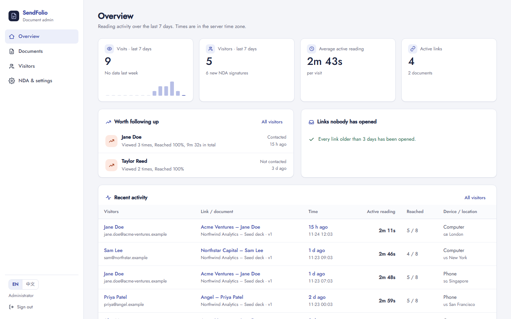
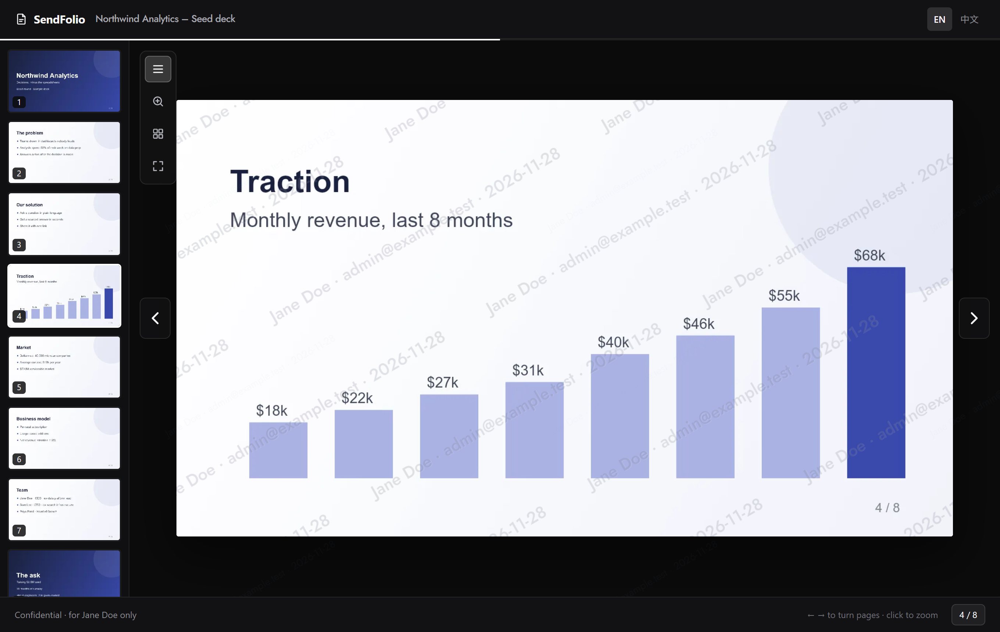
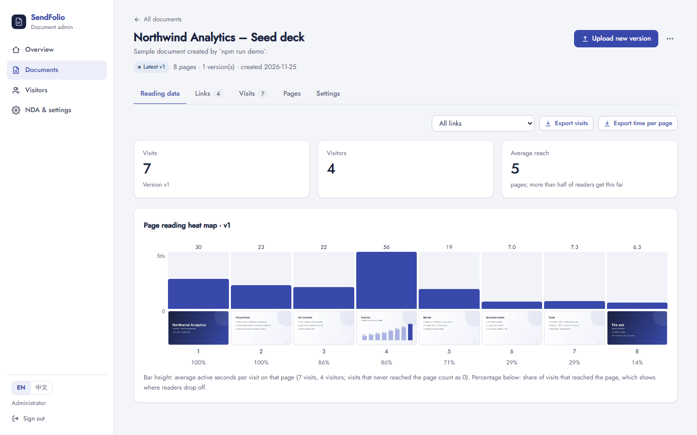
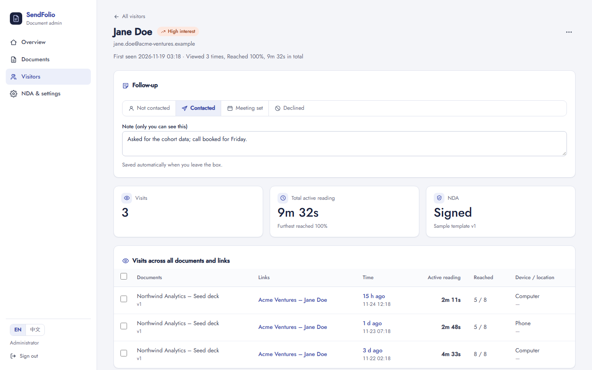
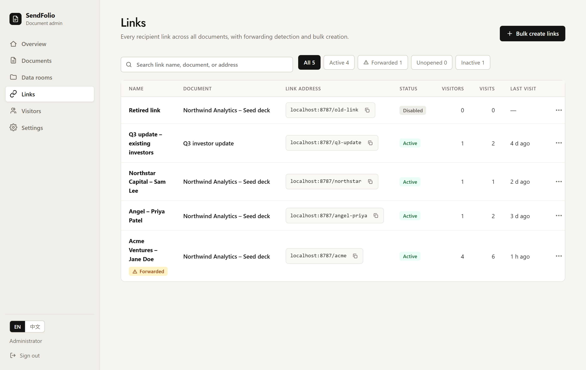
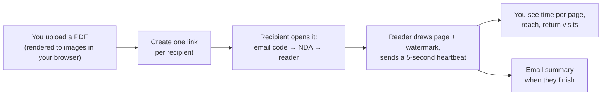

<p align="center">
  
</p>

<p align="center">
  <b>The free, self-hosted DocSend alternative for founders.</b><br>
  Send one link per person. Know who opened it, which pages they read, and for how long.
</p>

<p align="center">
  <a href="https://github.com/MurrayCMY/sendfolio/actions/workflows/ci.yml"></a>
  <a href="LICENSE"></a>
  
  
  
  <a href="CONTRIBUTING.md"></a>
</p>

<p align="center">
  <a href="#-try-it-in-two-minutes">Quick start</a> ·
  <a href="#-deploy-it-for-real">Deploy</a> ·
  <a href="#-features">Features</a> ·
  <a href="#-let-an-ai-agent-do-it">AI agents</a> ·
  <a href="docs/configuration.md">Docs</a> ·
  <a href="README.zh-CN.md">简体中文</a>
</p>

<br>

<p align="center">
  
</p>

## Why SendFolio

You are raising money, selling to enterprises or running a data room. You email a deck as a PDF, and then… silence.
Did they open it? Which slides held their attention? Did they forward it to someone else?

SendFolio gives each recipient **their own link**, asks them to **verify their email**, can have them **sign your NDA**, shows the
document in the browser with **their name watermarked on every page**, and tells you **how long they spent on each one**.

|  | Hosted document-sharing services | **SendFolio** |
|---|---|---|
| Cost | Per-seat subscription | **Free**, you only pay for a small server |
| Your documents and readers' data | On their servers | **On yours** |
| Name, domain, colours, language | Theirs | **Yours** (`docs.yourcompany.com`) |
| Source code | Closed | **Apache 2.0** |

## ✨ Features

<table>
  <tr>
    <td width="33%" valign="top">
      <h4>🔗 Links, presets &amp; bulk generator</h4>
      Custom addresses like <code>/acme</code>, 1-click security presets, bulk link creation (up to 50 recipients at once), and instant visitor preview.
    </td>
    <td width="33%" valign="top">
      <h4>📊 Page analytics &amp; version diff</h4>
      Time on every page, drop-off insights, version-to-version comparison (<code>v1</code> vs <code>v2</code>), forwarding detection, and a live “reading now” marker.
    </td>
    <td width="33%" valign="top">
      <h4>📁 Data rooms &amp; follow-up inbox</h4>
      Bundle multiple documents under one link and one NDA, track every visitor's status and private notes, and see who forwarded your deck.
    </td>
  </tr>
  <tr>
    <td valign="top">
      <h4>✉️ Verified access &amp; team admins</h4>
      Name + work email + 6-digit code, domain allowlists, visual personal-email blocklist, and multi-admin access for co-founders.
    </td>
    <td valign="top">
      <h4>📝 NDA with e-signature</h4>
      Readers accept your NDA first. Each acceptance becomes a PDF with time, IP and a hash of the exact text, emailed to the signer.
    </td>
    <td valign="top">
      <h4>💧 Dynamic watermark &amp; dark reader</h4>
      Obsidian gallery reader with name, email, IP and date baked into every page (and downloaded PDFs), plus an optional booking button.
    </td>
  </tr>
  <tr>
    <td valign="top">
      <h4>🎨 In-app branding</h4>
      Upload your logo, pick your brand colour, and add a “Book a call” button in the reader—all from Settings without touching code.
    </td>
    <td valign="top">
      <h4>🔔 Email, Slack &amp; Feishu / Lark alerts</h4>
      Real-time alerts when someone opens or forwards a link, plus reading summaries—with built-in 3-step setup guides.
    </td>
    <td valign="top">
      <h4>🌍 English &amp; 简体中文 · S3 ready</h4>
      Full bilingual UI, emails and PDFs, with local disk, Netlify Blobs, or S3-compatible storage (Cloudflare R2, AWS S3, Aliyun OSS, MinIO).
    </td>
  </tr>
</table>

## 🚀 Try it in two minutes

You need **Node.js 22+**. No database to install: the quick start uses an embedded one.

```bash
git clone https://github.com/MurrayCmy/sendfolio.git
cd sendfolio
npm install
npm run init -- --admin-email you@example.com   # creates .env with a fresh secret
npm run build
npm run demo     # optional: made-up sample data, so there is something to look at
npm start
```

Open **<http://localhost:8787/admin>** and sign in. Email is not configured yet, so the 6-digit code is printed in your terminal.
The demo data includes a sample reader link at <http://localhost:8787/acme>.

> [!TIP]
> This mode is for trying things out. For real use, deploy with Docker or Netlify below.

## 🌍 Deploy it for real

You need a domain (or subdomain), an SMTP account to send email (Resend, Gmail, Postmark, SES… anything SMTP) and about ten minutes.

| | Best for | Database | Files | Guide |
|---|---|---|---|---|
| 🐳 **Docker Compose** <br><sub>recommended</sub> | Any VPS or home server | PostgreSQL (included) | Docker volume | [Deploy with Docker →](docs/deploy-docker.md) |
| ▲ **Netlify** | No server to look after | Netlify Database or any Postgres | Netlify Blobs | [Deploy on Netlify →](docs/deploy-netlify.md) |
| 🚂 **Railway · Render · Fly.io** | Managed containers | Their Postgres | Mounted volume | [Container platforms →](docs/deploy-paas.md) |
| 💻 **Plain Node.js** | Laptops, tiny servers | Embedded or Postgres | Local folder | [Quick start](#-try-it-in-two-minutes) |

<details>
<summary><b>Docker Compose in four commands</b></summary>

```bash
git clone https://github.com/MurrayCmy/sendfolio.git && cd sendfolio
cp .env.example .env          # set SESSION_SECRET, ADMIN_EMAIL, SITE_URL, SMTP_*, DOMAIN
docker compose --profile https up -d --build
curl -fsS https://docs.yourcompany.com/healthz
```
Automatic HTTPS (Caddy) and PostgreSQL are included. Full guide: [docs/deploy-docker.md](docs/deploy-docker.md).
</details>

## 🤖 Let an AI agent do it

SendFolio is built to be deployed by coding agents: **Claude Code, Codex, Gemini CLI, Grok, Antigravity, Cursor**…
Open the repository in your agent and paste:

```text
Deploy SendFolio from this repository to [Docker on my VPS | Netlify | Railway].
Follow AGENTS.md. Ask me for anything you cannot find out yourself
(admin email, domain, SMTP credentials). When finished, run `npm run doctor`
and `npm test`, and tell me the admin URL.
```

[`AGENTS.md`](AGENTS.md) holds the step-by-step runbook for every target, the questions to ask you, and how to verify the result.
`npm run doctor -- --json` gives an agent a machine-readable health check.

## 📸 Screenshots

<table>
  <tr>
    <td width="50%"><br><sub><b>What the recipient sees</b>: the page, watermarked with their name</sub></td>
    <td width="50%"><br><sub><b>Where attention goes</b>: time per page across all readers</sub></td>
  </tr>
  <tr>
    <td><br><sub><b>Follow up</b>: every visit, status and private notes per person</sub></td>
    <td><br><sub><b>One link per recipient</b>, with custom addresses</sub></td>
  </tr>
  <tr>
    <td><br><sub><b>中文界面</b>: the whole product is available in Chinese</sub></td>
    <td align="center"><br><sub><b>Works on phones</b></sub></td>
  </tr>
</table>

## 🔍 How it works



- **Uploads happen in your browser.** It renders each PDF page to an image and uploads those, so readers only ever receive images.
- **Time is counted honestly.** A heartbeat only advances while the page is visible, the window is focused and the reader is active.
- **One code base, three runtimes**: a Node server (Docker, `npm start`) or Netlify Functions, on PostgreSQL or embedded PGlite.

More in [docs/architecture.md](docs/architecture.md).

## ⚙️ Configuration

Everything is an environment variable; [`.env.example`](.env.example) documents each one.

<details>
<summary><b>The ones you will touch</b></summary>

| Variable | What it does |
|---|---|
| `ADMIN_EMAIL` | Primary admin address (add co-founders in **Settings → Team** or comma-separate in `.env`) |
| `SITE_URL` | Your public address, e.g. `https://docs.yourcompany.com` |
| `SESSION_SECRET` | 32+ random characters (`npm run init` creates it) |
| `SMTP_HOST` `SMTP_USER` `SMTP_PASS` `MAIL_FROM` | Sending email |
| `APP_NAME` `COMPANY_NAME` | Your name in the UI, emails and NDA |
| `DEFAULT_LOCALE` | `en` or `zh` |
| `TIMEZONE` | e.g. `UTC`, `America/New_York`, `Asia/Shanghai` |
| `DATABASE_URL` | PostgreSQL. Empty = embedded database |

Full reference: [docs/configuration.md](docs/configuration.md) · Make it yours (name, colours, logo, NDA, new languages): [docs/customization.md](docs/customization.md)
</details>

## 🔒 Privacy and security

- Recipients are told what is recorded: name, email, time, IP address, device and time per page.
- Signed HttpOnly cookies, rate-limited login codes, explicit admin allowlist, no third-party scripts or fonts.
- A watermark deters leaks and lets you trace them; **it cannot stop someone photographing a screen**. Details in [SECURITY.md](SECURITY.md).

> [!IMPORTANT]
> The included NDA is a **sample template, not legal advice**. Have a lawyer approve the text you actually use.

## 🗺️ Status and roadmap

SendFolio is at **v0.3**. Docker Compose, plain Node and PostgreSQL are tested in CI on every commit.

- [x] Docker, Netlify and plain Node deployment · English and Chinese · NDA e-signature · watermarks · follow-up notes
- [x] Warm Paper & Obsidian Ink visual system · dark gallery reader · drag-and-drop upload · link presets · bulk link generator · 1-click preview as visitor
- [x] In-app branding & reader action button · forwarding detection · version-to-version analytics comparison
- [x] S3-compatible file storage (Cloudflare R2, AWS S3, Aliyun OSS, MinIO)
- [x] Team / co-founder admin access
- [x] Data rooms: several documents per link under one NDA
- [x] Real-time alerts: Slack, Feishu / Lark and generic webhooks with step-by-step setup guides
- [ ] More languages

Ideas and pull requests are welcome: [CONTRIBUTING.md](CONTRIBUTING.md).

## 📄 License

[Apache License 2.0](LICENSE). The name and logo are covered by [TRADEMARKS.md](TRADEMARKS.md); third-party notices are in [NOTICE](NOTICE).

<p align="center"><sub>Built for founders who would rather spend their time on the company than on the paperwork around it.</sub></p>
