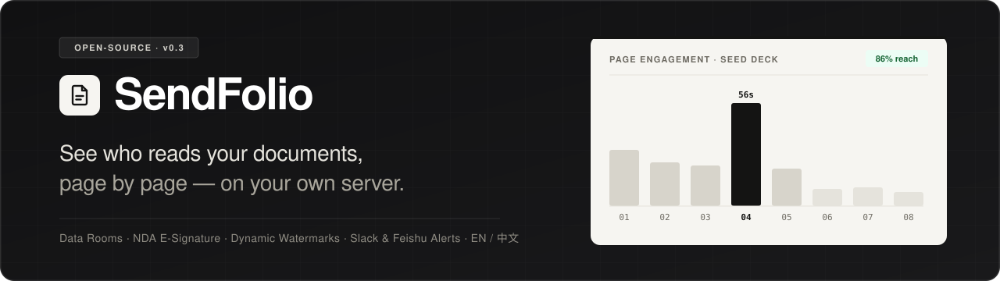
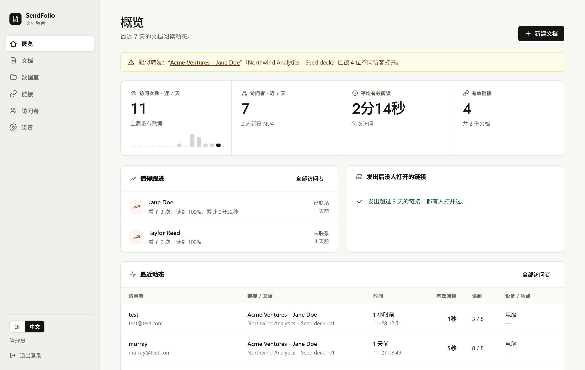
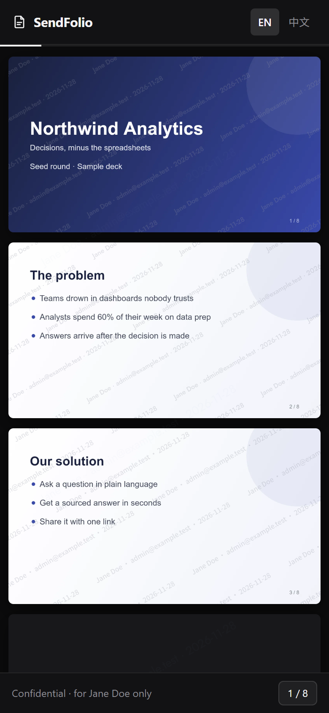
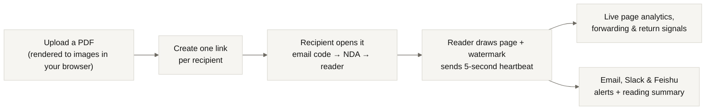

<p align="center">
  
</p>

<p align="center">
  <b>The free, self-hosted DocSend alternative for founders.</b><br>
  Send one link per person. Know who opened it, which pages held their attention, and when it was forwarded.
</p>

<p align="center">
  <a href="https://github.com/MurrayCMY/sendfolio/actions/workflows/ci.yml"></a>
  <a href="LICENSE"></a>
  
  
  
  <a href="CONTRIBUTING.md"></a>
</p>

<p align="center">
  <a href="#product-tour">Product tour</a> &nbsp;·&nbsp;
  <a href="#features">Features</a> &nbsp;·&nbsp;
  <a href="#try-it-in-two-minutes">Quick start</a> &nbsp;·&nbsp;
  <a href="#deploy-it-for-real">Deploy</a> &nbsp;·&nbsp;
  <a href="#let-an-ai-agent-do-it">AI agents</a> &nbsp;·&nbsp;
  <a href="docs/configuration.md">Docs</a> &nbsp;·&nbsp;
  <a href="README.zh-CN.md">简体中文</a>
</p>

<br>

<p align="center">
  
  <br>
  <sub><b>Overview</b> — 7-day reading pulse, forwarding alerts, follow-up signals, and recent visits in one calm workspace.</sub>
</p>

---

## Why SendFolio

You are raising a round, selling to enterprises, or running a data room. You attach a PDF to an email, and then… silence.
Did they open it? Which slides held their attention? Did they forward it to someone else?

SendFolio gives each recipient **their own link**, verifies **their email**, optionally has them **sign your NDA**, presents the document in an obsidian dark-gallery reader with **their name watermarked on every page**, and shows you **how long they spent on each slide**.

| | Hosted document-sharing services | **SendFolio** |
|---|---|---|
| **Cost** | Per-seat subscription | **Free** — you only pay for a small server |
| **Documents & reader data** | Stored on their servers | **Stored on yours** |
| **Brand, domain & language** | Theirs | **Yours** (`docs.yourcompany.com`) |
| **Source code** | Closed | **Apache 2.0** |

---

## Features

<table>
  <tr>
    <td width="33%" valign="top">
      <h4>Links, presets &amp; bulk generator</h4>
      Custom addresses like <code>/acme</code>, 1-click security presets, bulk link creation (up to 50 recipients at once), and instant visitor preview.
    </td>
    <td width="33%" valign="top">
      <h4>Page analytics &amp; version diff</h4>
      Active time per page, drop-off insights, version-to-version comparison (<code>v1</code> vs <code>v2</code>), forwarding detection, and a live “reading now” marker.
    </td>
    <td width="33%" valign="top">
      <h4>Data rooms &amp; follow-up inbox</h4>
      Bundle multiple documents under one link and one NDA, track every visitor's status and private notes, and spot high-intent return readers.
    </td>
  </tr>
  <tr>
    <td valign="top">
      <h4>Verified access &amp; team admins</h4>
      Name + work email + 6-digit code, domain allowlists, visual personal-email blocklist, and multi-admin access for co-founders.
    </td>
    <td valign="top">
      <h4>NDA with e-signature</h4>
      Readers accept your NDA before viewing. Each acceptance generates a timestamped PDF with IP and text hash, emailed to the signer.
    </td>
    <td valign="top">
      <h4>Dynamic watermark &amp; dark reader</h4>
      Obsidian gallery reader with name, email, IP, and date baked into every page (and downloaded PDFs), plus an optional booking button.
    </td>
  </tr>
  <tr>
    <td valign="top">
      <h4>In-app branding</h4>
      Upload your logo, pick your brand colour, and add a “Book a call” button in the reader — all from Settings without touching code.
    </td>
    <td valign="top">
      <h4>Email, Slack &amp; Feishu / Lark alerts</h4>
      Real-time alerts when someone opens or forwards a link, plus reading summaries — with built-in 3-step setup guides.
    </td>
    <td valign="top">
      <h4>English &amp; 简体中文 · S3 ready</h4>
      Full bilingual UI, emails, and PDFs, with local disk, Netlify Blobs, or S3-compatible storage (Cloudflare R2, AWS S3, Aliyun OSS, MinIO).
    </td>
  </tr>
</table>

---

## Product tour

<table>
  <tr>
    <td width="50%" valign="top">
      
      <br><br>
      <b>Obsidian gallery reader</b><br>
      <sub>Slides take center stage on a neutral dark canvas, with a per-viewer watermark and page thumbnails.</sub>
    </td>
    <td width="50%" valign="top">
      
      <br><br>
      <b>Per-page analytics &amp; insights</b><br>
      <sub>See active reading time on every slide, hover for breakdowns, and compare across deck versions.</sub>
    </td>
  </tr>
  <tr>
    <td width="50%" valign="top">
      
      <br><br>
      <b>Global links &amp; forwarding alerts</b><br>
      <sub>Manage every recipient link across documents, filter by status, and catch links opened by multiple people.</sub>
    </td>
    <td width="50%" valign="top">
      
      <br><br>
      <b>Visitor profile &amp; follow-up</b><br>
      <sub>Track NDA status, total active reading time, private notes, and every visit across your documents.</sub>
    </td>
  </tr>
  <tr>
    <td width="50%" valign="top">
      
      <br><br>
      <b>Full Chinese &amp; English UI</b><br>
      <sub>Switch languages in one click across the admin console, reader, emails, and NDA receipts.</sub>
    </td>
    <td width="50%" valign="top" align="center">
      
      <br><br>
      <b>Built for phones</b><br>
      <sub>Responsive vertical scroll on mobile with the same watermark protection and page progress.</sub>
    </td>
  </tr>
</table>

---

## Try it in two minutes

You need **Node.js 22+**. No database to install: quick start uses an embedded one.

```bash
git clone https://github.com/MurrayCMY/sendfolio.git
cd sendfolio
npm install
npm run init -- --admin-email you@example.com   # creates .env with a fresh secret
npm run build
npm run demo     # optional: sample data so you can explore immediately
npm start
```

Open **<http://localhost:8787/admin>** and sign in. Because email is not configured yet, the 6-digit login code is printed in your terminal.
The demo dataset includes a sample reader link at <http://localhost:8787/acme>.

> [!TIP]
> Local mode is for trying SendFolio out. For production use, deploy with Docker or Netlify below.

---

## Deploy it for real

You need a domain (or subdomain), an SMTP account to send email (Resend, Gmail, Postmark, SES… anything SMTP), and about ten minutes.

| Target | Best for | Database | Files | Guide |
|---|---|---|---|---|
| **Docker Compose** *(recommended)* | Any VPS or home server | PostgreSQL (included) | Docker volume | [Deploy with Docker →](docs/deploy-docker.md) |
| **Netlify** | Zero server maintenance | Netlify Database or any Postgres | Netlify Blobs | [Deploy on Netlify →](docs/deploy-netlify.md) |
| **Railway · Render · Fly.io** | Managed containers | Platform Postgres | Mounted volume | [Container platforms →](docs/deploy-paas.md) |
| **Plain Node.js** | Laptops, tiny servers | Embedded or Postgres | Local folder | [Quick start](#try-it-in-two-minutes) |

<details>
<summary><b>Docker Compose in four commands</b></summary>

```bash
git clone https://github.com/MurrayCMY/sendfolio.git && cd sendfolio
cp .env.example .env          # set SESSION_SECRET, ADMIN_EMAIL, SITE_URL, SMTP_*, DOMAIN
docker compose --profile https up -d --build
curl -fsS https://docs.yourcompany.com/healthz
```

Automatic HTTPS (Caddy) and PostgreSQL are included. Full guide: [docs/deploy-docker.md](docs/deploy-docker.md).
</details>

---

## Let an AI agent do it

SendFolio is designed to be deployed by coding agents: **Claude Code, Codex, Gemini CLI, Grok, Antigravity, Cursor**…
Open the repository in your agent and paste:

```text
Deploy SendFolio from this repository to [Docker on my VPS | Netlify | Railway].
Follow AGENTS.md. Ask me for anything you cannot find out yourself
(admin email, domain, SMTP credentials). When finished, run `npm run doctor`
and `npm test`, and tell me the admin URL.
```

[`AGENTS.md`](AGENTS.md) holds the step-by-step runbook for every target, the questions to ask you, and how to verify the result.
`npm run doctor -- --json` provides a machine-readable health check.

---

## How it works



- **Uploads happen in your browser.** Each PDF page is rendered to an image before upload, so readers only ever receive images.
- **Time is counted honestly.** The heartbeat only advances while the page is visible, the window is focused, and the reader is active.
- **One codebase, multiple runtimes.** Run as a Node server (Docker, `npm start`) or Netlify Functions, backed by PostgreSQL or embedded PGlite, and local disk, Netlify Blobs, or S3.

More in [docs/architecture.md](docs/architecture.md).

---

## Configuration

Everything is configured through environment variables; [`.env.example`](.env.example) documents each one.

<details>
<summary><b>Key environment variables</b></summary>

| Variable | What it does |
|---|---|
| `ADMIN_EMAIL` | Primary admin address (add co-founders in **Settings → Team** or comma-separate in `.env`) |
| `SITE_URL` | Your public address, e.g. `https://docs.yourcompany.com` |
| `SESSION_SECRET` | 32+ random characters (`npm run init` generates one) |
| `SMTP_HOST` `SMTP_USER` `SMTP_PASS` `MAIL_FROM` | Outgoing email |
| `APP_NAME` `COMPANY_NAME` | Your name in the UI, emails, and NDA |
| `DEFAULT_LOCALE` | `en` or `zh` |
| `TIMEZONE` | e.g. `UTC`, `America/New_York`, `Asia/Shanghai` |
| `DATABASE_URL` | PostgreSQL connection string (empty = embedded database) |

Full reference: [docs/configuration.md](docs/configuration.md) · Branding, NDA, and languages: [docs/customization.md](docs/customization.md)
</details>

---

## Privacy and security

- Recipients are told up front what is recorded: name, email, time, IP address, device, and time per page.
- Signed `HttpOnly` cookies, rate-limited login codes, explicit admin allowlist, and zero third-party scripts or fonts.
- A watermark deters leaks and lets you trace them; **it cannot stop someone photographing a screen**. Details in [SECURITY.md](SECURITY.md).

> [!IMPORTANT]
> The included NDA is a **sample template, not legal advice**. Have a lawyer approve the text you actually use.

---

## Roadmap

SendFolio is at **v0.3**. Docker Compose, plain Node, and PostgreSQL are tested in CI on every commit.

- [x] Docker, Netlify, and plain Node deployment · English & Chinese · NDA e-signature · dynamic watermarks · follow-up notes
- [x] Warm Paper & Obsidian Ink visual system · dark gallery reader · drag-and-drop upload · link presets · bulk link generator · 1-click preview as visitor
- [x] In-app branding & reader action button · forwarding detection · version-to-version analytics comparison
- [x] S3-compatible file storage (Cloudflare R2, AWS S3, Aliyun OSS, MinIO)
- [x] Team / co-founder multi-admin access
- [x] Data rooms: multiple documents under one link and one NDA
- [x] Real-time alerts: Slack, Feishu / Lark, and generic webhooks with 3-step setup guides
- [ ] More languages

Ideas and pull requests are welcome: [CONTRIBUTING.md](CONTRIBUTING.md).

---

## License

[Apache License 2.0](LICENSE). The name and logo are covered by [TRADEMARKS.md](TRADEMARKS.md); third-party notices are in [NOTICE](NOTICE).

<br>

<p align="center"><sub>Built for founders who would rather spend their time on the company than on the paperwork around it.</sub></p>
