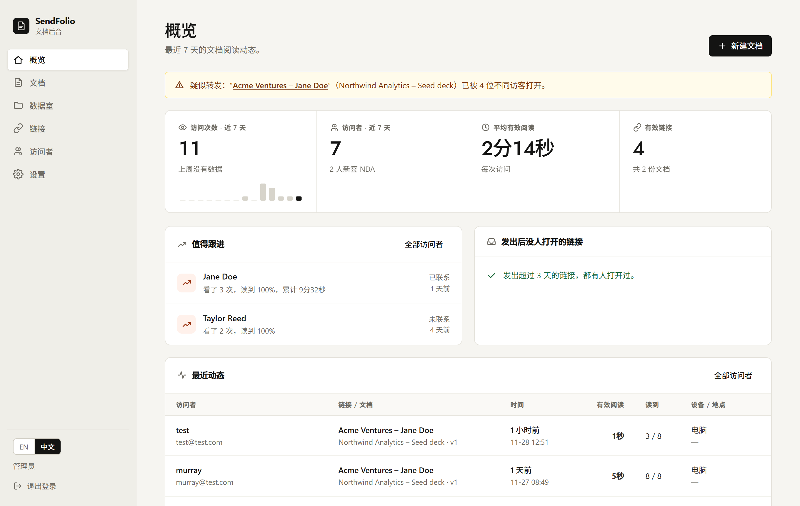
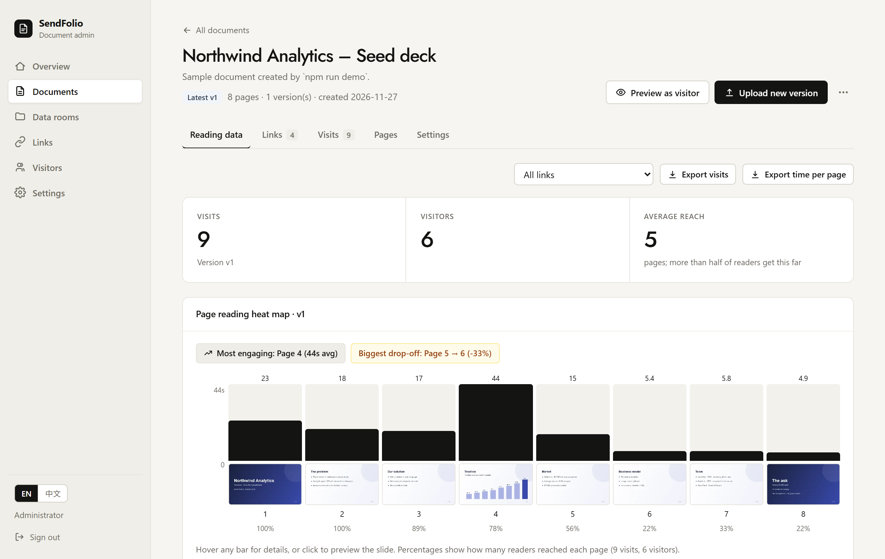
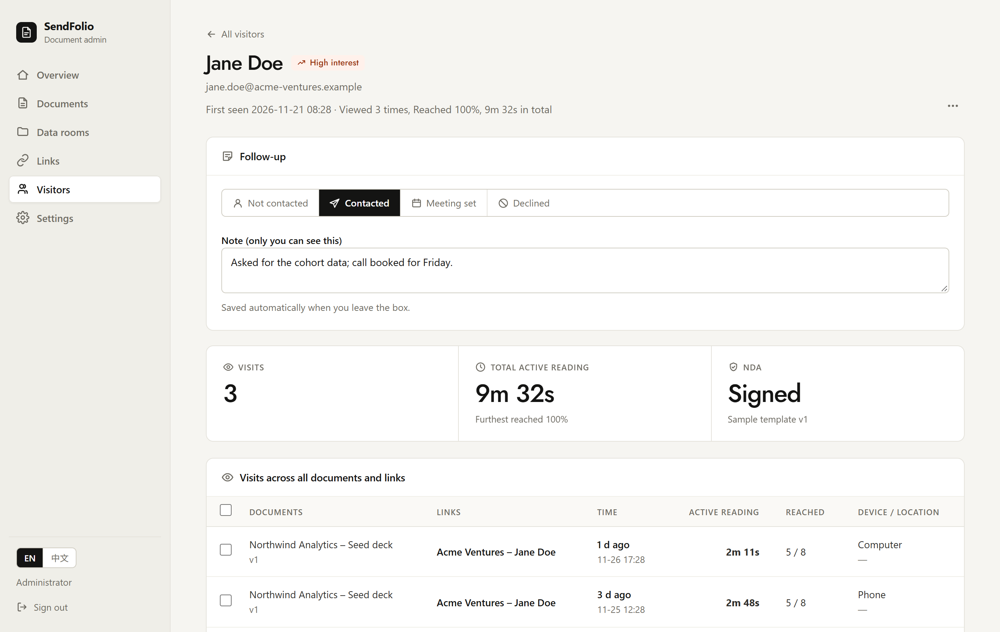
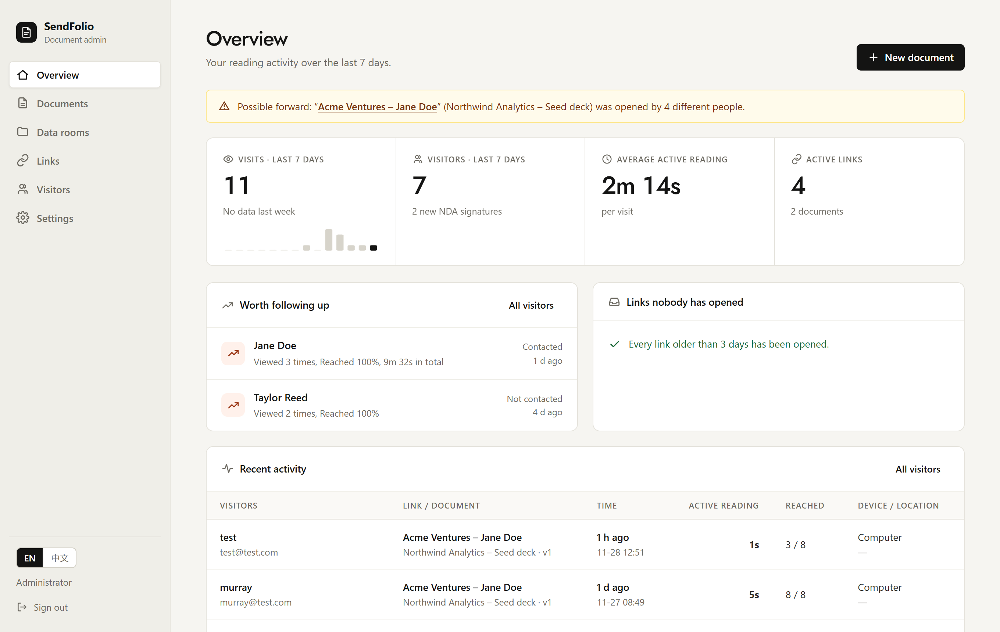
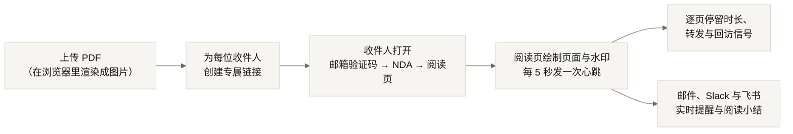

<p align="center">
  
</p>

<p align="center">
  <b>免费、可自托管的开源 DocSend 替代品，为创始人而做。</b><br>
  给每个人一个专属链接，知道谁打开了、哪几页看得最久、有没有被转发。
</p>

<p align="center">
  <a href="https://github.com/MurrayCMY/sendfolio/actions/workflows/ci.yml"></a>
  <a href="LICENSE"></a>
  
  
  
  <a href="CONTRIBUTING.md"></a>
</p>

<p align="center">
  <a href="#产品预览">产品预览</a> &nbsp;·&nbsp;
  <a href="#功能一览">功能一览</a> &nbsp;·&nbsp;
  <a href="#两分钟试用">快速开始</a> &nbsp;·&nbsp;
  <a href="#正式部署">部署</a> &nbsp;·&nbsp;
  <a href="#让-ai-助手替你部署">AI 助手</a> &nbsp;·&nbsp;
  <a href="docs/configuration.md">文档</a> &nbsp;·&nbsp;
  <a href="README.md">English</a>
</p>

<br>

<p align="center">
  
  <br>
  <sub><b>概览</b> — 7 天阅读趋势、转发提醒、值得跟进的访客与近期动态，一目了然。</sub>
</p>

---

## 为什么做 SendFolio

你在融资、做企业销售，或者搭建数据室。把 BP 以 PDF 发出去后，往往再无下文：对方打开了吗？哪几页看得最久？有没有转发给别人？

SendFolio 为每位收件人生成**专属链接**，验证**对方邮箱**，可选让对方先**签署 NDA**，在黑曜石深色画廊阅读器里展示文档并在**每一页打上对方的名字水印**，最后告诉你**对方在每一页停留了多久**。

| | 托管的文档分享服务 | **SendFolio** |
|---|---|---|
| **费用** | 按席位订阅 | **免费**，只需要一台小服务器 |
| **文档与读者数据** | 存在对方服务器上 | **存在你自己的服务器上** |
| **品牌、域名与语言** | 对方的 | **你的**（`docs.你的域名`） |
| **源代码** | 闭源 | **Apache 2.0** |

---

## 功能一览

<table>
  <tr>
    <td width="33%" valign="top">
      <h4>专属链接、预设与批量生成</h4>
      自定义地址（如 <code>/acme</code>）、一键安全预设、一次批量生成最多 50 条链接，以及一键以访客视角预览。
    </td>
    <td width="33%" valign="top">
      <h4>逐页分析与版本对比</h4>
      每页有效停留时长、流失洞察、不同版本对比（<code>v1</code> vs <code>v2</code>）、转发监测与“正在阅读”实时标记。
    </td>
    <td width="33%" valign="top">
      <h4>数据室与跟进清单</h4>
      一条链接、一份 NDA 打包分享整套资料；记录每位访客的跟进状态与私人备注，识别高意向回访者。
    </td>
  </tr>
  <tr>
    <td valign="top">
      <h4>邮箱验证与多管理员</h4>
      姓名 + 工作邮箱 + 6 位验证码，支持企业域名白名单、可视化个人邮箱拦截列表，以及联合创始人多管理员权限。
    </td>
    <td valign="top">
      <h4>NDA 电子签署</h4>
      对方先同意你的 NDA 再查看文档。每次签署自动生成含时间、IP 与协议文本哈希的 PDF，并邮件发给签署人。
    </td>
    <td valign="top">
      <h4>动态水印与深色阅读器</h4>
      黑曜石画廊阅读器，姓名、邮箱、IP 和日期烙印在每一页（以及下载的 PDF 上），并支持添加“预约会议”按钮。
    </td>
  </tr>
  <tr>
    <td valign="top">
      <h4>后台自定义品牌</h4>
      无需改代码，在设置里直接上传 Logo、调整品牌色，并为阅读页配置预约沟通按钮。
    </td>
    <td valign="top">
      <h4>邮件、Slack 与飞书 / Lark 提醒</h4>
      链接被打开、被转发或阅读完成时实时推送提醒与阅读小结，内置三步配置指引。
    </td>
    <td valign="top">
      <h4>中英双语 · 支持 S3 存储</h4>
      后台、阅读页、邮件和 NDA 回执完整支持中英文；支持本地磁盘、Netlify Blobs 与 S3 兼容存储（R2、S3、阿里云 OSS、MinIO）。
    </td>
  </tr>
</table>

---

## 产品预览

<table>
  <tr>
    <td width="50%" valign="top">
      
      <br><br>
      <b>黑曜石画廊阅读器</b><br>
      <sub>中性深色画布让幻灯片成为视觉焦点，每一页自动叠加密封式个人水印与缩略图导航。</sub>
    </td>
    <td width="50%" valign="top">
      
      <br><br>
      <b>逐页停留分析与洞察</b><br>
      <sub>直观查看每页有效阅读时长与流失情况，悬停查看细分数据，并支持多版本横向对比。</sub>
    </td>
  </tr>
  <tr>
    <td width="50%" valign="top">
      
      <br><br>
      <b>全局链接与转发监测</b><br>
      <sub>跨文档统一管理所有收件人链接，按状态快速筛选，自动标出被多人打开的疑似转发链接。</sub>
    </td>
    <td width="50%" valign="top">
      
      <br><br>
      <b>访客档案与跟进管理</b><br>
      <sub>集中查看 NDA 签署记录、累计有效阅读时长、私人跟进备注，以及跨文档的全部访问轨迹。</sub>
    </td>
  </tr>
  <tr>
    <td width="50%" valign="top">
      
      <br><br>
      <b>完整中英双语界面</b><br>
      <sub>管理后台、阅读器、通知邮件与 NDA 签署回执均可一键切换中英文。</sub>
    </td>
    <td width="50%" valign="top" align="center">
      
      <br><br>
      <b>移动端流畅阅读</b><br>
      <sub>手机端自适应竖向滚动，保留完整的个人水印保护与页码进度指示。</sub>
    </td>
  </tr>
</table>

---

## 两分钟试用

需要 **Node.js 22+**。不用装数据库：试用模式自带嵌入式数据库。

```bash
git clone https://github.com/MurrayCMY/sendfolio.git
cd sendfolio
npm install
npm run init -- --admin-email you@example.com   # 生成 .env 和随机密钥
npm run build
npm run demo     # 可选：写入示例数据，方便立刻体验
npm start
```

打开 **<http://localhost:8787/admin>** 登录。因为尚未配置邮件，6 位登录验证码会直接打印在终端里。示例数据包含一条读者链接：<http://localhost:8787/acme>。

> [!TIP]
> 本地模式仅用于快速体验。正式使用请用下方的 Docker 或 Netlify 部署。

---

## 正式部署

你需要一个域名（或子域名）、一个能发邮件的 SMTP 账号（Resend、Gmail、Postmark、SES 等均可），以及约十分钟时间。

| 方式 | 适合场景 | 数据库 | 文件存储 | 指南 |
|---|---|---|---|---|
| **Docker Compose** *（推荐）* | 任何 VPS 或自有服务器 | PostgreSQL（已包含） | Docker 卷 | [用 Docker 部署 →](docs/deploy-docker.md) |
| **Netlify** | 不想维护服务器 | Netlify Database 或任意 Postgres | Netlify Blobs | [部署到 Netlify →](docs/deploy-netlify.md) |
| **Railway · Render · Fly.io** | 托管容器平台 | 平台 Postgres | 挂载卷 | [容器平台 →](docs/deploy-paas.md) |
| **直接用 Node.js** | 笔记本、小型服务器 | 嵌入式或 Postgres | 本地目录 | [快速开始](#两分钟试用) |

<details>
<summary><b>四条命令用 Docker Compose 部署</b></summary>

```bash
git clone https://github.com/MurrayCMY/sendfolio.git && cd sendfolio
cp .env.example .env          # 填写 SESSION_SECRET、ADMIN_EMAIL、SITE_URL、SMTP_*、DOMAIN
docker compose --profile https up -d --build
curl -fsS https://docs.你的域名/healthz
```

已包含自动 HTTPS（Caddy）和 PostgreSQL。完整指南：[docs/deploy-docker.md](docs/deploy-docker.md)。
</details>

> [!NOTE]
> 如果服务器在中国大陆，用域名对外提供服务需要 ICP 备案。不想备案的话，可以选择香港或新加坡节点。

---

## 让 AI 助手替你部署

SendFolio 专门为 AI 编程助手能顺利部署而设计：**Claude Code、Codex、Gemini CLI、Grok、Antigravity、Cursor** 等。用助手打开这个仓库，然后粘贴：

```text
请把这个仓库里的 SendFolio 部署到【我的 VPS 上用 Docker | Netlify | Railway】。
请遵循 AGENTS.md。凡是你查不到的信息（管理员邮箱、域名、SMTP 凭据）请向我询问。
完成后运行 `npm run doctor` 和 `npm test`，并告诉我后台地址。
```

[`AGENTS.md`](AGENTS.md) 包含各部署方式的分步手册、需要向你确认的问题，以及验证方法。`npm run doctor -- --json` 为助手提供机器可读的健康检查。

---

## 工作原理



- **上传在你的浏览器里完成**：PDF 每一页都会在本地渲染成图片后再上传，读者端永远只拿到图片。
- **时间统计很诚实**：只有页面可见、窗口处于焦点且读者在操作时，心跳才会计时。
- **一套代码，多种运行方式**：支持 Node 服务器（Docker、`npm start`）或 Netlify Functions，搭配 PostgreSQL 或内置 PGlite，以及本地磁盘、Netlify Blobs 或 S3 存储。

更多见 [docs/architecture.md](docs/architecture.md)。

---

## 配置

全部通过环境变量配置，[`.env.example`](.env.example) 对每一项都有说明。

<details>
<summary><b>常用环境变量</b></summary>

| 变量 | 作用 |
|---|---|
| `ADMIN_EMAIL` | 主管理员邮箱（可在**设置 → 团队**中添加联合创始人，或在 `.env` 中用逗号分隔） |
| `SITE_URL` | 你的公开访问地址，如 `https://docs.你的域名` |
| `SESSION_SECRET` | 32 位以上随机字符（`npm run init` 自动生成） |
| `SMTP_HOST` `SMTP_USER` `SMTP_PASS` `MAIL_FROM` | 发件邮箱配置 |
| `APP_NAME` `COMPANY_NAME` | 界面、邮件和 NDA 里显示的名称 |
| `DEFAULT_LOCALE` | `en` 或 `zh` |
| `TIMEZONE` | 如 `UTC`、`America/New_York`、`Asia/Shanghai` |
| `DATABASE_URL` | PostgreSQL 连接串；留空则使用内置数据库 |

完整参考：[docs/configuration.md](docs/configuration.md) · 自定义品牌、NDA 与语言：[docs/customization.md](docs/customization.md)
</details>

---

## 隐私与安全

- 访问者会被明确告知记录了哪些信息：姓名、邮箱、时间、IP 地址、设备和每页停留时间。
- 签名的 `HttpOnly` Cookie、频率限制的登录验证码、显式管理员白名单，不加载任何第三方脚本或字体。
- 水印用来威慑并追溯泄露，**拦不住手机拍屏幕**。详见 [SECURITY.md](SECURITY.md)。

> [!IMPORTANT]
> 自带的 NDA 只是**示例模板，不构成法律意见**。正式使用的文本请让律师确认。

---

## 路线图

SendFolio 当前版本为 **v0.3**。Docker Compose、直接用 Node 和 PostgreSQL 都在每次提交的 CI 里自动测试。

- [x] Docker、Netlify 和直接用 Node 部署 · 中英双语 · NDA 电子签署 · 动态水印 · 跟进备注
- [x] 暖纸黑墨视觉体系 · 黑曜石画廊阅读器 · 拖拽上传 · 安全预设 · 批量生成链接 · 一键以访客视角预览
- [x] 后台自定义品牌与阅读页预约按钮 · 转发监测提醒 · 多版本阅读数据对比
- [x] 兼容 S3 的对象存储（Cloudflare R2、AWS S3、阿里云 OSS、MinIO）
- [x] 团队 / 联合创始人多管理员权限
- [x] 数据室：一条链接、一份 NDA 分享整套资料
- [x] 实时推送提醒：Slack、飞书 / Lark 与通用 Webhook（附三步配置指引）
- [ ] 更多语言

欢迎提想法和 PR：[CONTRIBUTING.md](CONTRIBUTING.md)。

---

## 许可证

[Apache License 2.0](LICENSE)。名称和 logo 的使用见 [TRADEMARKS.md](TRADEMARKS.md)，第三方声明见 [NOTICE](NOTICE)。

<br>

<p align="center"><sub>为那些宁愿把时间花在公司上，而不是文书工作上的创始人而做。</sub></p>
