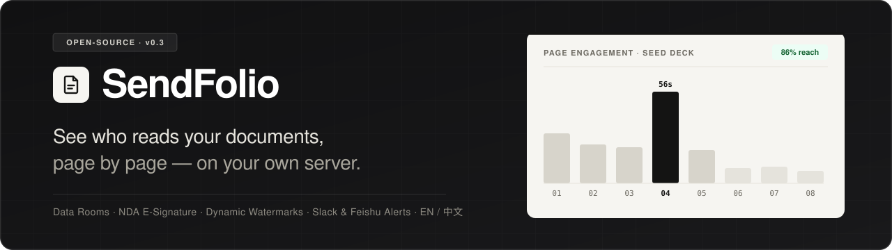
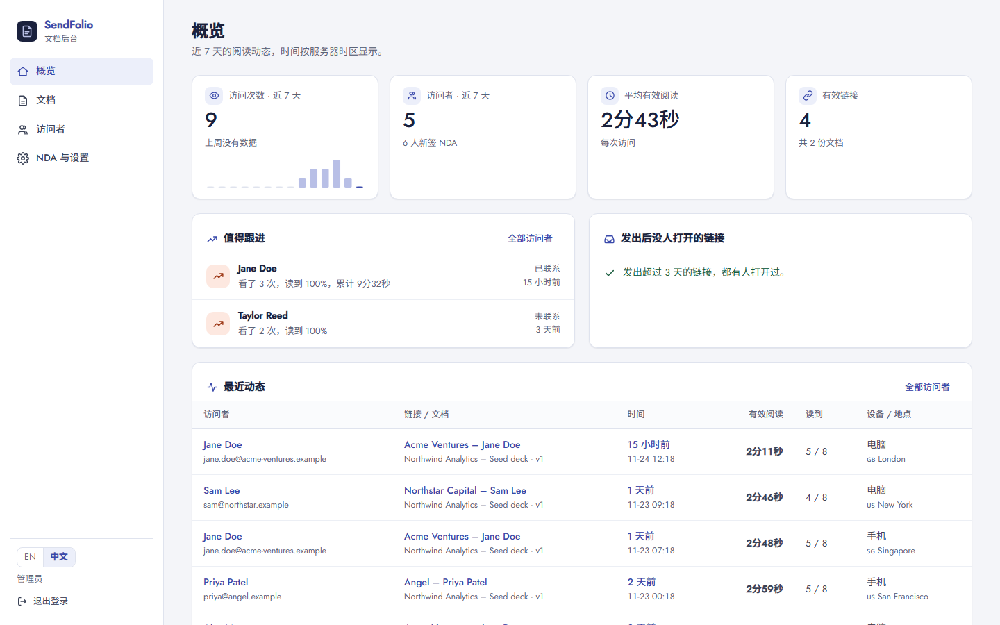
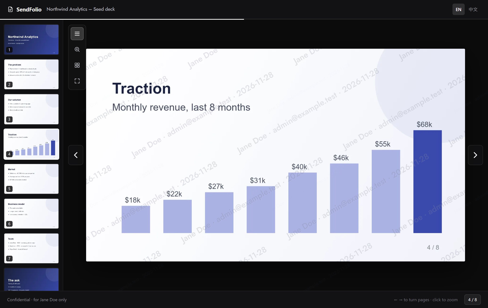
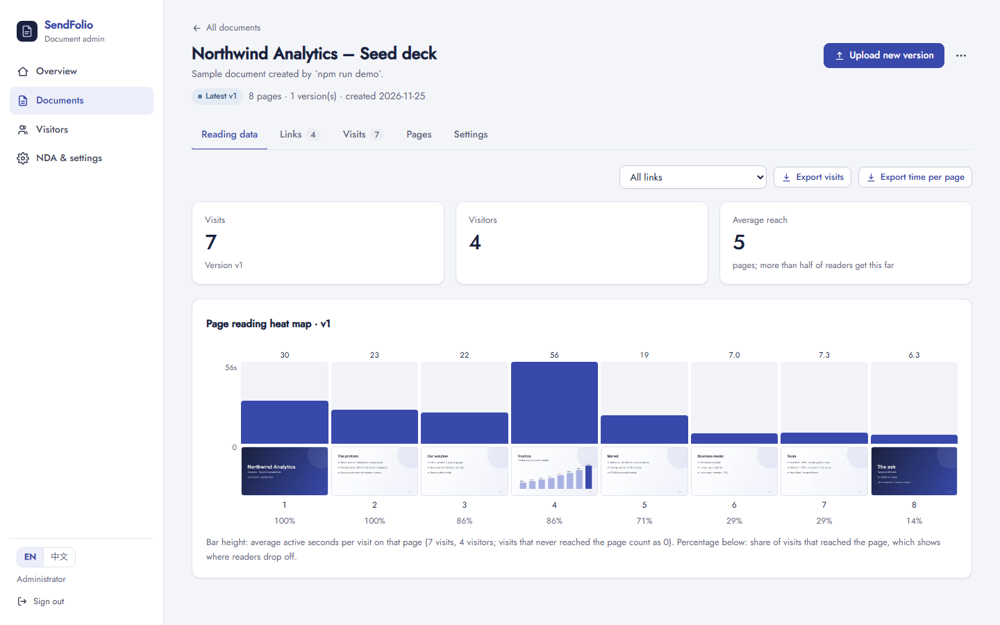
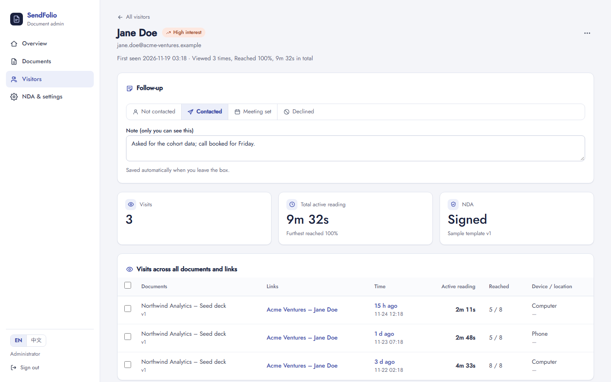
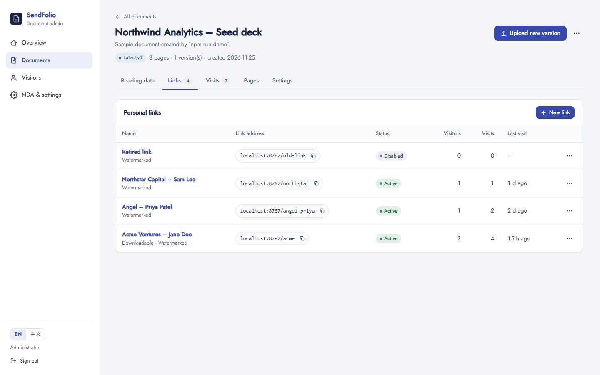
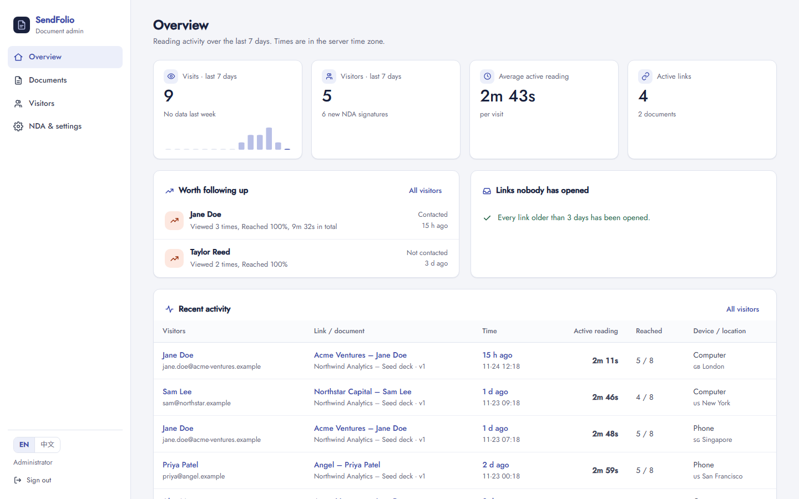
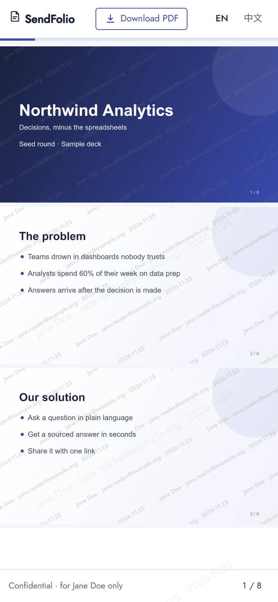
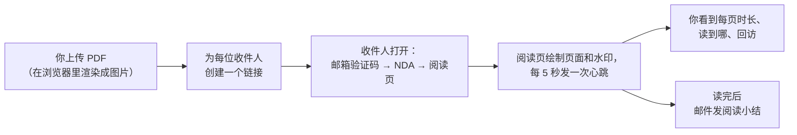

<p align="center">
  
</p>

<p align="center">
  <b>免费、可自托管的开源 DocSend 替代品，为创始人而做。</b><br>
  给每个人一个专属链接，知道谁打开了、读了哪几页、读了多久。
</p>

<p align="center">
  <a href="https://github.com/MurrayCmy/sendfolio/actions/workflows/ci.yml"></a>
  <a href="LICENSE"></a>
  
  
  
  <a href="CONTRIBUTING.md"></a>
</p>

<p align="center">
  <a href="#-两分钟试用">快速开始</a> ·
  <a href="#-正式部署">部署</a> ·
  <a href="#-功能">功能</a> ·
  <a href="#-让-ai-助手替你部署">AI 助手</a> ·
  <a href="docs/configuration.md">文档</a> ·
  <a href="README.md">English</a>
</p>

<br>

<p align="center">
  
</p>

## 为什么做 SendFolio

你在融资、做企业销售，或者在搭建数据室。你把 BP 以 PDF 发出去，然后就没有下文了：对方打开了吗？哪几页看得最久？有没有转发给别人？

SendFolio 为每位收件人生成**专属链接**，要求对方**验证邮箱**，可以让对方**签署 NDA**，在浏览器里展示文档并在**每一页水印上对方的名字**，最后告诉你**对方在每一页停留了多久**。

|  | 托管的文档分享服务 | **SendFolio** |
|---|---|---|
| 费用 | 按席位订阅 | **免费**，只需要一台小服务器 |
| 文档和读者数据 | 在对方的服务器上 | **在你自己的服务器上** |
| 名称、域名、配色、语言 | 对方的 | **你的**（`docs.你的域名`） |
| 源代码 | 闭源 | **Apache 2.0** |

## ✨ 功能

<table>
  <tr>
    <td width="33%" valign="top">
      <h4>🔗 每人一个专属链接</h4>
      自定义地址（如 <code>/acme</code>）、有效期、访问密码，随时停用或删除。
    </td>
    <td width="33%" valign="top">
      <h4>📊 逐页阅读分析</h4>
      每页停留时长、读到哪一页、所有读者的热力图、回访，以及“正在阅读”提示。
    </td>
    <td width="33%" valign="top">
      <h4>📬 跟进清单</h4>
      看出谁回访、谁读得深；设置跟进状态（已联系、已约见、已婉拒）并写私人备注。
    </td>
  </tr>
  <tr>
    <td valign="top">
      <h4>✉️ 邮箱验证</h4>
      姓名 + 工作邮箱 + 6 位验证码。可拒绝个人邮箱，或只允许指定公司域名。
    </td>
    <td valign="top">
      <h4>📝 NDA 电子签署</h4>
      对方先同意你的 NDA。每次签署生成一份 PDF（时间、IP、协议文本哈希），并邮件发给签署人。
    </td>
    <td valign="top">
      <h4>💧 动态水印</h4>
      姓名、邮箱、IP 和时间烙印在每一页（下载的 PDF 也有），显示哪些字段由你选择。
    </td>
  </tr>
  <tr>
    <td valign="top">
      <h4>🖼️ 给图片，不给 PDF</h4>
      页面以图片形式提供，并带防篡改检测；可选带水印的 PDF 下载。
    </td>
    <td valign="top">
      <h4>🔔 通知</h4>
      有人打开链接时发邮件，读完后再发一封阅读小结，列出停留最久的页面。
    </td>
    <td valign="top">
      <h4>🌍 中英双语</h4>
      后台、阅读页、邮件和 PDF 都支持英文和简体中文，添加新语言只需一个文件。
    </td>
  </tr>
</table>

## 🚀 两分钟试用

需要 **Node.js 22+**。不用装数据库：试用模式使用内置数据库。

```bash
git clone https://github.com/MurrayCmy/sendfolio.git
cd sendfolio
npm install
npm run init -- --admin-email you@example.com   # 生成 .env 和随机密钥
npm run build
npm run demo     # 可选：写入一些虚构的示例数据，方便先看看效果
npm start
```

打开 **<http://localhost:8787/admin>** 登录。还没配置邮件，所以 6 位验证码会打印在终端里。示例数据里有一个读者链接：<http://localhost:8787/acme>。

> [!TIP]
> 这个模式只用于试用。正式使用请用下面的 Docker 或 Netlify 部署。

## 🌍 正式部署

你需要：一个域名（或子域名）、一个能发邮件的 SMTP 账号（Resend、Gmail、Postmark、SES 等都行），以及十来分钟。

| | 适合 | 数据库 | 文件 | 指南 |
|---|---|---|---|---|
| 🐳 **Docker Compose** <br><sub>推荐</sub> | 任何 VPS 或家用服务器 | PostgreSQL（已包含） | Docker 卷 | [用 Docker 部署 →](docs/deploy-docker.md) |
| ▲ **Netlify** | 不想管服务器 | Netlify Database 或任意 Postgres | Netlify Blobs | [部署到 Netlify →](docs/deploy-netlify.md) |
| 🚂 **Railway · Render · Fly.io** | 托管容器平台 | 平台的 Postgres | 挂载卷 | [容器平台 →](docs/deploy-paas.md) |
| 💻 **直接用 Node.js** | 笔记本、小型服务器 | 内置或 Postgres | 本地目录 | [快速开始](#-两分钟试用) |

<details>
<summary><b>四条命令用 Docker Compose 部署</b></summary>

```bash
git clone https://github.com/MurrayCmy/sendfolio.git && cd sendfolio
cp .env.example .env          # 填写 SESSION_SECRET、ADMIN_EMAIL、SITE_URL、SMTP_*、DOMAIN
docker compose --profile https up -d --build
curl -fsS https://docs.你的域名/healthz
```
已包含自动 HTTPS（Caddy）和 PostgreSQL。完整指南：[docs/deploy-docker.md](docs/deploy-docker.md)。
</details>

> [!NOTE]
> 如果服务器在中国大陆，用域名对外提供服务需要 ICP 备案。不想备案的话，可以选择香港或新加坡节点。

## 🤖 让 AI 助手替你部署

SendFolio 专门为 AI 编程助手能顺利部署而设计：**Claude Code、Codex、Gemini CLI、Grok、Antigravity、Cursor** 等。用助手打开这个仓库，然后粘贴：

```text
请把这个仓库里的 SendFolio 部署到【我的 VPS 上用 Docker | Netlify | Railway】。
请遵循 AGENTS.md。凡是你查不到的信息（管理员邮箱、域名、SMTP 凭据）请向我询问。
完成后运行 `npm run doctor` 和 `npm test`，并告诉我后台地址。
```

[`AGENTS.md`](AGENTS.md) 包含各部署方式的分步手册、需要向你确认的问题，以及验证方法。`npm run doctor -- --json` 为助手提供机器可读的健康检查。

## 📸 截图

<table>
  <tr>
    <td width="50%"><br><sub><b>收件人看到的</b>：页面，水印是 TA 的名字</sub></td>
    <td width="50%"><br><sub><b>注意力在哪</b>：所有读者在每页的阅读时长</sub></td>
  </tr>
  <tr>
    <td><br><sub><b>跟进</b>：每个人的所有访问、状态和私人备注</sub></td>
    <td><br><sub><b>每位收件人一个链接</b>，可自定义地址</sub></td>
  </tr>
  <tr>
    <td><br><sub><b>English UI</b>：整个产品都有英文版</sub></td>
    <td align="center"><br><sub><b>手机上也好用</b></sub></td>
  </tr>
</table>

## 🔍 工作原理



- **上传在你的浏览器里完成**：把 PDF 每一页渲染成图片再上传，读者拿到的永远只是图片。
- **时间统计很诚实**：只有页面可见、窗口有焦点且读者在操作时，心跳才会计时。
- **一套代码，三种运行方式**：Node 服务器（Docker、`npm start`）或 Netlify Functions，数据库用 PostgreSQL 或内置 PGlite。

更多见 [docs/architecture.md](docs/architecture.md)。

## ⚙️ 配置

全部用环境变量配置，[`.env.example`](.env.example) 对每一项都有说明。

<details>
<summary><b>你会改到的几项</b></summary>

| 变量 | 作用 |
|---|---|
| `ADMIN_EMAIL` | 唯一能登录 `/admin` 的邮箱 |
| `SITE_URL` | 你的公开地址，如 `https://docs.你的域名` |
| `SESSION_SECRET` | 32 位以上随机字符（`npm run init` 会生成） |
| `SMTP_HOST` `SMTP_USER` `SMTP_PASS` `MAIL_FROM` | 发邮件 |
| `APP_NAME` `COMPANY_NAME` | 界面、邮件和 NDA 里显示的名称 |
| `DEFAULT_LOCALE` | `en` 或 `zh` |
| `TIMEZONE` | 如 `UTC`、`America/New_York`、`Asia/Shanghai` |
| `DATABASE_URL` | PostgreSQL；留空则用内置数据库 |

完整参考：[docs/configuration.md](docs/configuration.md) · 自定义名称、配色、logo、NDA 和新语言：[docs/customization.md](docs/customization.md)
</details>

## 🔒 隐私与安全

- 访问者会被告知记录了哪些信息：姓名、邮箱、时间、IP 地址、设备和每页停留时间。
- 签名的 HttpOnly Cookie、有频率限制的登录验证码、只接受一个管理员邮箱、不加载任何第三方脚本或字体。
- 水印用来威慑并追溯泄露，**拦不住拍屏幕**。详见 [SECURITY.md](SECURITY.md)。

> [!IMPORTANT]
> 自带的 NDA 只是**示例模板，不构成法律意见**。正式使用的文本请让律师确认。

## 🗺️ 状态与路线图

SendFolio 还很年轻（**v0.1**）。Docker Compose、直接用 Node 和 PostgreSQL 都在每次提交的 CI 里测试。

- [x] Docker、Netlify 和直接用 Node 部署 · 中英双语 · NDA 电子签署 · 水印 · 跟进备注
- [ ] 兼容 S3 的文件存储（用于多副本和托管平台）
- [ ] 团队成员和角色
- [ ] 数据室：一个链接包含多份文档
- [ ] Webhook 以及 Slack / 飞书通知
- [ ] 更多语言

欢迎提想法和 PR：[CONTRIBUTING.md](CONTRIBUTING.md)。

## 📄 许可证

[Apache License 2.0](LICENSE)。名称和 logo 的使用见 [TRADEMARKS.md](TRADEMARKS.md)，第三方声明见 [NOTICE](NOTICE)。

<p align="center"><sub>为那些宁愿把时间花在公司上，而不是文书工作上的创始人而做。</sub></p>
